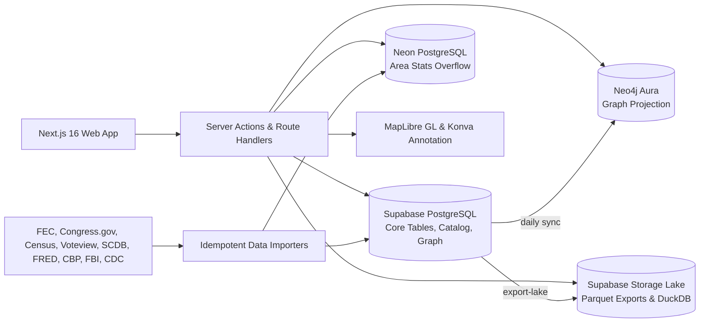

# Worldview

Worldview is a public-data intelligence platform for understanding the United States: immigration, crime, the economy, elections, political money, Congress, and the people and institutions behind them. Every figure links back to the government record, agency dataset, or published study it came from.

[](https://github.com/PrestonParis/worldview/actions/workflows/ci.yml) · **Live:** [worldviewpolitics.com](https://www.worldviewpolitics.com)

---

## The Platform at a Glance

Worldview operates on two coordinated layers:
1. **Public Issue Hubs & State Profiles:** Curated, source-verified reference pages covering 13 core policy domains and all 50 states.
2. **The Tools Suite:** Flexible workspaces designed for deep research, cross-dataset correlation, opposition analysis, and real-time election tracking.

### Core Tool Suite

| Tool | Focus | Capabilities |
| :--- | :--- | :--- |
| **[Subpoena](/tools/subpoena)** | **People, Money & Networks** | Sourced case files on political figures and organizations. Itemized FEC Schedule A contributions (excluding memo lines), Schedule E independent expenditures, Senate LDA lobbying registrations, power network graphs (~14,000 entities), and verified verbatim quotes. |
| **[Writ](/tools/writ)** | **Legislation & Elections** | Dockets for congressional bills, members, and races. DW-NOMINATE ideological polarization, roll-call party unity and defector analysis, Supreme Court (SCDB) docket tracking, and the live **Georgia close-races election-night tracker**. |
| **[IssueView](/tools/issueview)** | **Cross-Topic Analytics** | Bivariate correlation analysis, unconstrained metric combination across agencies (e.g., FBI crime vs. Census median income), geographic state and county rankings, and clean CSV/JSON exports. |
| **[Atlas](/atlas)** | **Political Philosophy** | Multi-axis political philosophy engine measuring policy positions across governance, economics, culture, and foreign policy, alongside a historical taxonomy of political movements and traditions. |

### Public Reference Hubs

* **Issues:** [Immigration](/immigration) (CBP encounters, asylum, ICE detention, foreign-born trends, state flows), [Crime](/crime) (FBI CDE, violent crime, NCVS underreporting, city police staffing), [Guns](/guns) (CDC injury mortality, Gallup ownership trends), [Abortion](/abortion) (Guttmacher monthly trends, CDC surveillance).
* **Economy:** [Economy](/economy) (FRED indicators, CPI inflation, GDP, payrolls, household income), [Housing](/housing) (Case-Shiller, homeownership, rent burden), [Health Care](/healthcare) (uninsured rates, Medicaid/Medicare, overdose mortality), [Energy](/energy) (emissions, electricity mix, fuel prices).
* **Society:** [Demographics](/demographics) (Census PEP, race forecasts, ancestry, urban/rural distribution), [Education](/education) (NAEP math/reading proficiency, student loan debt), [Religion](/religion) (Pew Religious Landscape Study, Gallup historical trends), [Family](/family) (marriage, divorce, fertility rates).
* **Government & Power:** [Legislation](/legislation) (bills, roll calls, member ideology), [Elections](/elections) (historical presidential and Senate returns, county choropleths), [Spending](/spending) (OMB historical receipts/outlays, Treasury debt to the penny, payment accuracy), [States](/states) (comparative dashboards for all 50 states), [My Government](/my-government) (address lookup for federal, state, and local representatives).

---

## Architecture



### Engineering Highlights

* **Two-Database Tiered Storage:** Relational records (bills, votes, claims, entities, edges, contributions) and dataset catalogs live in Supabase PostgreSQL (`DATABASE_URL`). High-volume statistical observations (`area_stats`) that exceed storage limits route dynamically to Neon PostgreSQL (`NEON_DATABASE_URL`). `src/lib/db/stores.ts` seamlessly splits writes and merges cross-database queries.
* **Dual Graph Architecture:** The canonical entity graph (~14,000 people and organizations, with external crosswalk IDs for Bioguide, FEC, ICPSR, Open States, and Wikidata) lives in PostgreSQL. A read-only replica is synced daily to Neo4j Aura for deep traversal and Cypher path queries (`npm run graph:sync`).
* **DuckDB-Ready Parquet Data Lake:** Analytical extracts of every published dataset (`area-stats/<slug>.parquet`) and public table are generated weekly (`npm run data:lake`). Researchers and data scientists can query them directly via DuckDB, Polars, pandas, or R from public URLs.
* **Idempotent Ingestion & External Identifiers:** Importers resolve entities through a crosswalk (`entity_identifiers`) and use upserts on natural keys (`source, metric, geo_level, geoid, period`), guaranteeing that interrupted or repeated runs never duplicate data.
* **Strict Validation & Role-Gated Mutations:** Shared Zod schemas (`src/lib/validation/`) validate batch API ingest (`POST /api/ingest/batch`), server actions, and editor forms. Shared data edits require the `editor` role, enforced server-side.
* **Forward-Only Migrations:** Dated SQL files in `supabase/sql/` are automatically verified and applied during CI and production deploys before Next.js builds.

---

## Tech Stack

* **Frontend:** Next.js 16 (App Router), React 19, TypeScript 5, Tailwind CSS v4, MapLibre GL 6, React-Konva
* **Backend:** Server Actions, Route Handlers, Zod 4, Drizzle ORM
* **Databases & Storage:** Supabase PostgreSQL & Auth, Neon PostgreSQL, Neo4j Aura, Supabase Storage (Parquet Data Lake)
* **Testing & Quality:** Vitest (537 tests across 64 test files), Playwright (E2E browser smoke tests), ESLint 9, Prettier
* **Infrastructure & CI:** Vercel, GitHub Actions, Docker Compose

---

## Testing & Quality

Run the complete validation suite:

```bash
npm run check       # Format check, ESLint, TypeScript typecheck, Vitest
npm run build       # Production build with automatic migration precheck
npm run test:e2e    # Playwright desktop and mobile browser smoke tests
```

The Vitest suite includes **537 unit and integration tests across 64 files**, covering:
* Validation schemas and batch ingestion rules
* FEC contribution normalization and deduplication
* DW-NOMINATE calculations and election-margin evaluations
* Georgia close-races election-night runoff and recount criteria
* Demographic projection and forecasting models
* Address-to-representative lookup pipelines
* Authentication guards and role permissions

---

## Local Development

### 1. Prerequisites
* Node.js 20+
* Docker Desktop (required for local PostgreSQL and Neo4j)

### 2. Install Dependencies

```bash
npm install
```

### 3. Configure Environment

```bash
cp .env.example .env.local
```

Worldview supports seamless switching between local Docker containers and cloud staging:
* `npm run env:docker` — switch `.env.local` to local Docker services
* `npm run env:cloud` — switch `.env.local` to cloud staging
* `npm run env:status` — view the active Supabase target

### 4. Start Infrastructure

```bash
npm run infra:up      # Starts local Supabase and Neo4j Docker containers
```

*(Use `npm run infra:down` to shut down containers, and `npm run infra:status` to check health.)*

### 5. Run Migrations & Seed

```bash
npm run db:migrate    # Applies pending SQL migrations in supabase/sql/
npm run db:seed       # Idempotent fixture seed (entities, sample elections)
npm run graph:sync    # Rebuilds the Neo4j graph copy from PostgreSQL
```

### 6. Start Development Server

```bash
npm dev
```

* **Web Application:** [http://localhost:3001](http://localhost:3001) *(port 3001 by default)*
* **Local Supabase Studio:** [http://localhost:54323](http://localhost:54323)
* **Neo4j Browser:** [http://localhost:7474](http://localhost:7474)

---

## Key Operational & Data Scripts

| Command | Description |
| :--- | :--- |
| `npm run import:all` | Run all public data importers in dependency order (`-- quick` skips long sweeps) |
| `npm run import:profile -- <file>` | Ingest a structured JSON political dossier into Subpoena records |
| `npm run sync:ga-results` | Pull latest election returns for Georgia close-races tracking |
| `npm run data:lake` | Export all published datasets and tables as Parquet to the public storage lake |
| `npm run db:rebalance` | Rebalance dataset storage between Supabase and Neon to prevent disk overflow |
| `npm run data:health` | Run health check on importers, stale data, and refresh schedules |
| `npm run data:merge-entities` | Identify and merge duplicate entities based on verified FEC/Bioguide IDs |
| `npm run db:export` | Point-in-time database export to `backups/<timestamp>/` |
| `npm run db:restore-postgres -- <dir>` | Restore tables idempotently from a backup directory |
| `npm run auth:role -- <email> <role>` | Grant an account `editor` or `admin` permissions |

See [docs/data-sources.md](docs/data-sources.md) for detailed documentation on all 65 public datasets, API keys, and importer flags.

---

## Deployment & GitHub Actions

Production deploys run on Vercel backed by Supabase Pro, Neon, and Neo4j Aura.

* `ci.yml`: Format, lint, typecheck, unit tests, migrations in isolated Postgres, production build, and Playwright smoke tests.
* `post-deploy.yml`: Applies pending database migrations and backfills missing catalog entries post-deploy.
* `sync-public-data.yml`, `sync-legislation.yml`, `sync-money.yml`: Scheduled weekly syncs from Congress.gov, OpenFEC, and federal agencies.
* `sync-graph.yml`: Daily sync from Postgres to Neo4j Aura (maintains active instance status).
* `export-lake.yml`: Weekly Parquet lake rebuild and data health report.
* `ga-results-watch.yml`, `ga-results-daily.yml`, `ga-results-health.yml`: Real-time election-night monitoring and certification watchdog for Georgia contests.

---

## License

Licensed under the [MIT License](LICENSE).
