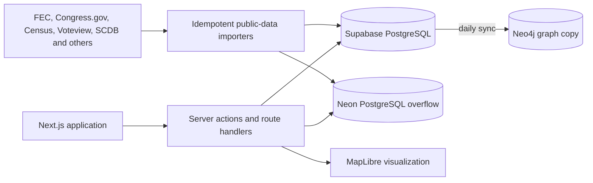

# Worldview

Worldview is a public-data platform for understanding the United States: immigration, crime, the economy, elections, political money, Congress, and the people and institutions behind them. Every figure links back to the government record or published study it came from.

 · **Live:** [worldviewpolitics.com](https://www.worldviewpolitics.com)


## Features

- Browse issue hubs for immigration, crime, guns, health care, energy, the economy, housing, education, abortion, demographics, religion, family, and government spending, each with sources and methods.
- Compare all 50 states on one page each, drawing on the same datasets as the issue hubs.
- Search a catalog of 57 public datasets from 40 publishers, with a documented read API and a keyed partner API for institutions that publish their own.
- Open a sourced case file on any person or organization in **Subpoena**: biography, relationships, political money and quotes, built from structured records.
- Follow bills, members and races in **Writ**, including a live Georgia close-races report ranked by vote margin on election night.
- Chart, map and compare any statistic by place in **IssueView**.
- Browse bills, roll-call votes, committees, court cases, and executive actions.
- Trace contributions, lobbying registrations, and independent expenditures.
- Look up the federal, state, and local offices representing a U.S. address.
- Compare election results, demographics, and geography through maps and projections.
- Take a versioned political quiz whose results can be revisited, shared, and claimed without storing raw edit tokens.

## Architecture



Worldview uses PostgreSQL for structured records such as claims, sources, bills, votes, contributions, elections, and quiz sessions. Area-level statistics that outgrow the Supabase plan's size cap live in a second PostgreSQL database on Neon. Each dataset sits wholly in one database, recorded in `datasets.storage`, and a rebalance script moves datasets between the two. The People & Power graph (entities, their relationships, and an ID crosswalk to Bioguide, FEC, ICPSR, Open States, Wikidata, LDA, and other identifiers) lives in PostgreSQL too, so bills, votes, money, and elections reference entities through foreign keys. A daily job rebuilds a read-only copy in Neo4j for path and network queries. Importers resolve people and organizations through the crosswalk and use upserts so interrupted or repeated runs do not duplicate data. Server actions and shared Zod schemas keep interactive edits and batch ingestion on the same validation boundary.

## Tech stack

- **Frontend:** Next.js 16, React 19, TypeScript, Tailwind CSS, MapLibre GL
- **Backend:** Server Actions, Route Handlers, Zod, Drizzle ORM
- **Data:** Supabase PostgreSQL and Auth, Neon PostgreSQL, Neo4j Aura, public government datasets and APIs
- **Infrastructure:** Vercel, GitHub Actions for CI, migrations, and scheduled data sync, Docker Compose for local services
- **Quality:** Vitest, Playwright, ESLint, Prettier

## Engineering highlights

- **Stores with explicit ownership.** PostgreSQL is the record for every relational record and the entity graph, Neo4j holds a synced copy of the graph for traversal, and large statistical datasets are routed between Supabase and Neon per dataset to stay inside free-tier size limits.
- **Forward-only migrations.** Dated, idempotent SQL files are applied on every production build before `next build`, so a deploy never ships code ahead of its tables.
- **Idempotent ingestion.** Stable source IDs, an entity ID crosswalk, unique indexes, and upserts make imports resumable and safe to rerun.
- **Source-aware public data.** Importers preserve external identifiers and provenance across FEC, Congress.gov, Census, Voteview, the Supreme Court Database, and other public sources.
- **Guarded editing.** Anyone can browse or sign up; changing shared data takes an editor role checked inside every server action. The Supabase Data API is closed with row-level security on every table, partner API keys are stored only as SHA-256 hashes, and quiz edit tokens live in httpOnly cookies with only their hashes in the database.
- **Recoverable operations.** Export, restore, dry-run, cursor, and audit-report workflows were added after real recovery incidents exposed the need for stronger operational boundaries.

## Testing

```bash
npm run check
npm run build
npm run test:e2e
```

About 520 unit tests across 63 files, plus desktop and mobile browser smoke tests that CI runs against a production build on a fresh database built from the migrations. The suite covers validation, money and election calculations, legislation helpers, authentication guards, demographic forecasting, government lookup, public-data utilities, the political quiz engine, and migration safety checks.

## Deployment

Production runs on Vercel against Supabase, Neon, and Neo4j Aura. Browsing is open to everyone; anyone can register with email and password, confirmed by an emailed code. New accounts are members, and editing shared data requires the editor role.

GitHub Actions workflows (`.github/workflows/`):

- `ci.yml`: formatting, lint, tests and typecheck, then migrations into an empty Postgres, a production build and Chromium smoke tests, on every push to `main` and every pull request.
- `post-deploy.yml`: after each successful production deploy, applies pending migrations and loads any catalog dataset that has no rows yet.
- `sync-legislation.yml`, `sync-money.yml`, `sync-public-data.yml`: weekly refreshes from Congress.gov, the FEC, and the agency datasets.
- `sync-graph.yml`: a daily rebuild of the Neo4j graph copy from PostgreSQL, which also keeps the free Aura instance from pausing.
- `export-lake.yml`: weekly Parquet exports to the data lake and a data health report (failing importers, datasets behind their cadence).
- `ga-results-watch.yml`, `ga-results-daily.yml`, `ga-results-health.yml`: the election-night ingest for the Georgia close-races report, its daily follow-up until certification, and a watchdog (see docs/elections/ga-close-races-runbook.md).

## Status and next steps

Worldview is live at [worldviewpolitics.com](https://www.worldviewpolitics.com) and under active development. Lint, tests, typecheck, and the production build pass. Before wider promotion, sign-up needs a CAPTCHA (Cloudflare Turnstile is wired in but not yet configured in production) and anonymous quiz creation needs rate limiting. The databases run on free tiers, so large imports are size-checked first.

Built with AI-assisted development (Claude Code).

## Local development

### 1. Install dependencies

```bash
npm install
```

### 2. Configure

```bash
cp .env.example .env.local
```

The defaults point at the local stack. `.env.example` documents every variable; API keys
for the importers are optional. If you keep `.env.local.docker` and `.env.cloud` copies,
`npm run env:docker` / `npm run env:cloud` switch between them and `npm run env:status`
shows which is active. Postgres/Auth and Neo4j always move together, never split.

The graph (~14,000 people and organizations) lives in Postgres. Neo4j only holds a copy:
`npm run graph:sync` rebuilds it from Postgres, so a paused or wiped Aura instance loses
nothing. `npm run graph:import-neo4j` is the one-time copy of an older Neo4j-only graph
into Postgres (ids are kept).

### 3. Start infrastructure (Docker required for local Postgres/Neo4j)

```bash
npm run infra:up      # supabase start + the Neo4j container
```

`npm run infra:down` stops both. `npm run infra:status` shows what's running. On
`env:cloud` with an Aura URI, you don't need `infra:up` at all.

### 4. Apply migrations

```bash
npm run db:migrate
```

Builds the schema from the dated `supabase/sql/` files, applying only pending ones (`npm run
dev` also does this first). Safe to re-run. `npm run db:studio` opens Drizzle Studio.

### 5. Seed (optional)

```bash
npm run db:seed       # idempotent — a few entities and one certified election
npm run graph:sync    # copy the entities into Neo4j
```

Enough to make every page render without empty states. Safe on a populated database
(upserts on fixed IDs).

### 6. Run it

```bash
npm run dev
```

- App: [http://localhost:3001](http://localhost:3001) (not 3000 — kept free for other local projects)
- Local Supabase Studio: [http://localhost:54323](http://localhost:54323) (only in `env:docker` mode)
- Neo4j Browser: [http://localhost:7474](http://localhost:7474) (local Docker only)

### 7. Sign in

Editing and account pages require a session. `src/proxy.ts` (Next 16 renamed
`middleware.ts` to `proxy.ts`) refreshes it on each request; the ingest API has its
own bearer-token authentication. Anyone can create an account with email and password,
confirmed by an emailed code; a forgotten password is reset the same way. New accounts
are members, who own their quizzes and saved governments. Changing shared data needs an editor,
granted with `npm run auth:role -- <email> editor`.

## Adding data

Records come in through idempotent importers (`npm run import:*`), the `/data` editor
forms, or `POST /api/ingest/batch`, all validated against the same Zod schemas in
`src/lib/validation/`. Every importer, its source, the tables it writes and the key it
needs are listed in [docs/data-sources.md](docs/data-sources.md); `npm run import:all`
runs the full load in dependency order.

## Backups and recovery

Two incidents drove this: the cloud Postgres lost `claims` / `sources` to a bad
script, and — separately — `.env.local` got repointed at an empty Neo4j Aura instance
while the real graph sat untouched in the local Docker Neo4j. Neither store had a
backup. The graph has since moved into Postgres, so Neo4j holds nothing that
`npm run graph:sync` can't rebuild. Now:

- **`npm run db:export`** — point-in-time dump to `backups/<timestamp>/` (one JSON file
  per Postgres table, the entity graph included, + `manifest.json`). Run it before any destructive change and on a schedule. `backups/`
  is gitignored except the two committed recovery snapshots; copy anything else you
  want to keep somewhere durable.
- **`npm run db:restore-postgres -- <dir>`** — replays `sources` / `claims` /
  `contributions` from a dump directory, idempotently (`ON CONFLICT DO NOTHING`).
- **`npm run graph:sync`** — rebuilds Neo4j from Postgres.
- **`npm run data:lake`** — Parquet copies of every dataset and record table in the
  public `lake` Storage bucket; raw source files can be kept in `raw`. See
  `docs/data-sources.md`.
- **`npm run db:seed`** — the floor: a known-good minimal fixture for a from-empty
  database (see step 5).

## Project layout

- `src/app/(shell)/` — the public pages: issue hubs (`immigration`, `crime`, `economy`, ...),
  `states`, `spending`, `people`, `money`, `legislation`, `elections`, `my-government`,
  `datasets`, `quiz`, `atlas`, the `subpoena`, `writ` and `issueview` tools, and the `data/`
  editor CRUD, sharing the header nav.
- `src/app/geography/` — the map/annotation studio, deliberately outside the shell
  (full-bleed, its own chrome) and limited to the site owner's account.
- `src/app/api/` — route handlers: batch ingest, the public data API, quiz, search, Writ.
- `src/lib/db/` — data access for every Postgres table, the entity graph included.
- `src/lib/validation/` — the Zod schemas everything else (forms, server actions, ingest)
  validates against. Start here when adding a field.
- `src/lib/actions/` — `"use server"` mutations, each guarded by role or ownership.
- `src/components/<domain>/` — the UI for each page or tool; `src/components/tools/` holds
  the shared tool shell and the three workspaces, `src/components/{map,annotate,layout}/`
  the Geography studio.
- `scripts/` — importers and operational commands (see [scripts/README.md](scripts/README.md)).
- `tests/e2e/` — Playwright smoke tests.

More in [docs/](docs/README.md): architecture, data sources, auth, the quiz, Geography,
people profiles and the close-races report.

## Infra

- `infra/docker/docker-compose.yml` — the local Neo4j container.
- `supabase/config.toml` — local Supabase CLI config.
- `supabase/sql/` — dated migrations, applied in order by `scripts/migrate.mjs`
  (`supabase/sql/neon/` for the Neon database).
- `drizzle.config.ts` — reads `DATABASE_URL` from `.env.local`; throws if it's missing
  rather than silently defaulting anywhere.

## License

Licensed under the [MIT License](LICENSE).
