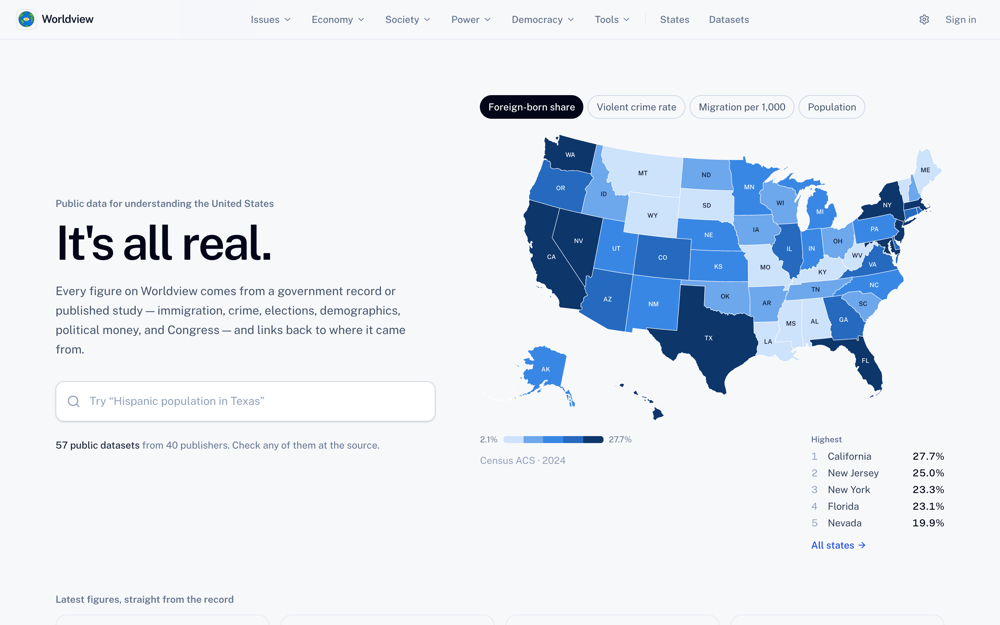
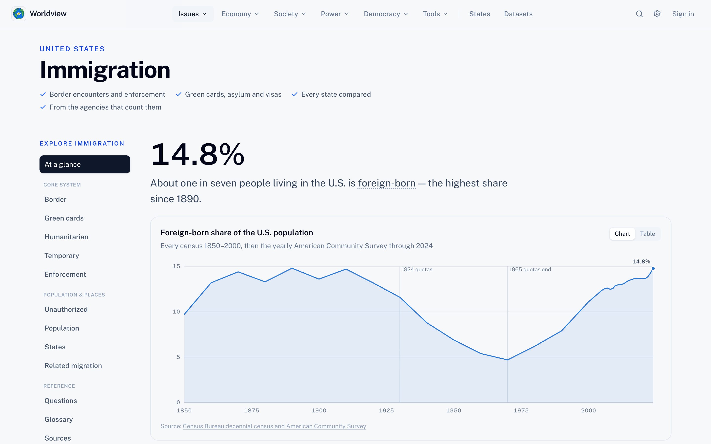
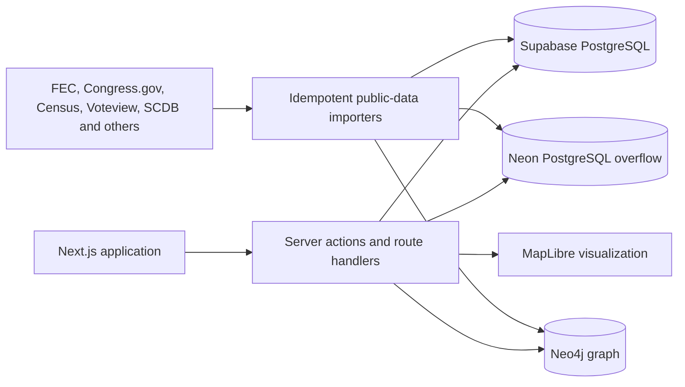

# Worldview

Worldview is a public-data platform for understanding the United States: immigration, crime, the economy, elections, political money, Congress, and the people and institutions behind them. Every figure links back to the government record or published study it came from.

 · **Live:** [worldview-tawny.vercel.app](https://worldview-tawny.vercel.app)





## Features

- Browse issue hubs for immigration, crime, guns, health care, energy, the economy, housing, education, abortion, demographics, religion, family, and government spending, each with sources and methods.
- Compare all 50 states on one page each, drawing on the same datasets as the issue hubs.
- Search a catalog of 57 public datasets from 40 publishers, with a documented read API and a keyed partner API for institutions that publish their own.
- Explore people and organizations as a relationship graph backed by normalized public records.
- Follow bills, roll-call votes, committees, court cases, and executive actions.
- Trace contributions, lobbying registrations, and independent expenditures.
- Look up the federal, state, and local offices representing a U.S. address.
- Compare election results, demographics, and geography through maps and projections.
- Take a versioned political quiz whose results can be revisited, shared, and claimed without storing raw edit tokens.

## Architecture



Worldview uses PostgreSQL for structured records such as claims, sources, bills, votes, contributions, elections, and quiz sessions. Area-level statistics that outgrow the Supabase plan's size cap live in a second PostgreSQL database on Neon. Each dataset sits wholly in one database, recorded in `datasets.storage`, and a rebalance script moves datasets between the two. Neo4j stores entities and relationships that benefit from traversal and graph visualization. Importers link the two stores through stable external identifiers and use upserts or `MERGE` operations so interrupted or repeated runs do not duplicate data. Server actions and shared Zod schemas keep interactive edits and batch ingestion on the same validation boundary.

## Tech stack

- **Frontend:** Next.js 16, React 19, TypeScript, Tailwind CSS, MapLibre GL
- **Backend:** Server Actions, Route Handlers, Zod, Drizzle ORM
- **Data:** Supabase PostgreSQL and Auth, Neon PostgreSQL, Neo4j Aura, public government datasets and APIs
- **Infrastructure:** Vercel, GitHub Actions for CI, migrations, and scheduled data sync, Docker Compose for local services
- **Testing:** Vitest and ESLint

## Engineering highlights

- **Stores with explicit ownership.** Relational records stay queryable and constrained in PostgreSQL, entities and edges live in Neo4j for graph traversal, and large statistical datasets are routed between Supabase and Neon per dataset to stay inside free-tier size limits.
- **Forward-only migrations.** Dated, idempotent SQL files are applied on every production build before `next build`, so a deploy never ships code ahead of its tables.
- **Idempotent ingestion.** Stable source IDs, unique indexes, upserts, and Neo4j `MERGE` calls make imports resumable and safe to rerun.
- **Source-aware public data.** Importers preserve external identifiers and provenance across FEC, Congress.gov, Census, Voteview, the Supreme Court Database, and other public sources.
- **Guarded editing.** Anyone can browse or sign up; changing shared data takes an editor role checked inside every server action. The Supabase Data API is closed with row-level security on every table, partner API keys are stored only as SHA-256 hashes, and quiz edit tokens live in httpOnly cookies with only their hashes in the database.
- **Recoverable operations.** Export, restore, dry-run, cursor, and audit-report workflows were added after real recovery incidents exposed the need for stronger operational boundaries.

## Testing

```bash
npm test
npm run lint
```

355 tests across 40 files. The suite covers validation, money and election calculations, legislation helpers, authentication guards, demographic forecasting, government lookup, public-data utilities, the political quiz engine, and migration safety checks.

## Deployment

Production runs on Vercel against Supabase, Neon, and Neo4j Aura. Browsing is open to everyone; anyone can register with email and password, confirmed by an emailed code. New accounts are members, and editing shared data requires the editor role.

GitHub Actions workflows (`.github/workflows/`):

- `ci.yml`: lint, tests, and typecheck on every push to `main` and every pull request.
- `post-deploy.yml`: after each successful production deploy, applies pending migrations and loads any catalog dataset that has no rows yet.
- `sync-legislation.yml`, `sync-money.yml`, `sync-public-data.yml`: weekly refreshes from Congress.gov, the FEC, and the agency datasets.
- `purge-quizzes.yml`: daily cleanup of unclaimed anonymous quiz sessions.
- `keepalive-neo4j.yml`: a daily query so the free Neo4j Aura instance doesn't pause.

## Status and next steps

Worldview is live at [worldview-tawny.vercel.app](https://worldview-tawny.vercel.app) and under active development. Lint, tests, typecheck, and the production build pass. Before wider promotion, sign-up needs a CAPTCHA (Cloudflare Turnstile is wired in but not yet configured in production) and anonymous quiz creation needs rate limiting. The databases run on free tiers, so large imports are size-checked first.

**Demo video:** TODO — add a short product walkthrough.

Built with AI-assisted development (Claude Code); `CLAUDE.md` and `AGENTS.md` hold the agent instructions used in this repository.

## Local development

### 1. Install dependencies

```bash
npm install
```

### 2. Choose an environment

```bash
npm run env:docker   # fully local: Supabase CLI + Docker Neo4j
npm run env:cloud    # cloud: Supabase project + Neo4j Aura
```

Each copies a template (`.env.local.docker` / `.env.cloud`) to `.env.local`.
`npm run env:status` shows which is active. Both stores move together — Postgres/Auth
and Neo4j are always either both local or both cloud, never split.

The graph (~18,000 people and organizations) lives in both the local Docker Neo4j and the cloud
Aura instance. Keep them in sync with `npm run db:migrate-neo4j`
(see [Backups](#backups-and-recovery)). Neo4j Aura Free instances **pause after 3 days
idle and are deleted after 30 days idle** with no point-in-time restore, so run
`npm run db:export` on a schedule if the cloud copy matters.

### 3. Start infrastructure (Docker required for local Postgres/Neo4j)

```bash
npm run infra:up      # supabase start + the Neo4j container
```

`npm run infra:down` stops both. `npm run infra:status` shows what's running. On
`env:cloud` with an Aura URI, you don't need `infra:up` at all.

### 4. Push the schema (Postgres side only — Neo4j has none to push)

```bash
npm run db:push
```

Safe to re-run; only applies what's changed. `npm run db:studio` opens Drizzle Studio.

### 5. Seed (optional)

```bash
npm run db:seed       # idempotent — a few entities and an edge (Neo4j only)
```

Enough to make every page render without empty states. Safe on a populated database
(MERGE on fixed IDs).

### 6. Run it

```bash
npm run dev
```

- App: [http://localhost:3001](http://localhost:3001) (not 3000 — kept free for other local projects)
- Local Supabase Studio: [http://localhost:54323](http://localhost:54323) (only in `env:docker` mode)
- Neo4j Browser: [http://localhost:7474](http://localhost:7474) (local Docker only)

### 7. Sign in

Editing and account pages require a session. `src/proxy.ts` (Next 16 renamed
`middleware.ts` to `proxy.ts`) refreshes it on each request; the ingest API has its
own bearer-token authentication. Anyone can create an account with email and password,
confirmed by an emailed code; a forgotten password is reset the same way. New accounts
are members, who own their maps and quizzes. Changing shared data needs an editor,
granted with `npm run auth:role -- <email> editor`.

## Adding data

Four ways in, all validated against the same Zod schemas:

- **By hand**: `/data` in the app — forms for entities, relationships, claims, sources,
  bills, contributions, elections.
- **Programmatically**: `POST /api/ingest/batch` with `Authorization: Bearer <INGEST_API_KEY>`.
  Accepts any combination of `entities`/`sources`/`edges`/`claims`/`elections`/`candidacies`
  arrays in one request. Give an item a `clientId` and reference it from a later item in the
  same batch as `"$ref:<clientId>"` to link records that don't exist yet (e.g. a candidacy
  referencing the election created earlier in the same call). `elections`/`candidacies` items
  may carry an `externalId` — when present the write is an idempotent upsert on that key.
  See `src/lib/ingest/batch.ts`.
- **FEC donor import**: `npm run import:fec-donors` pulls organizational (PAC/committee)
  contributions for a pilot set of politicians from the free OpenFEC API into
  `contributions`, creating committee entities in Neo4j as it goes. Recipients must
  already exist as `politician` entities. Set `FEC_API_KEY` in `.env.local` for a real
  rate limit (the shared `DEMO_KEY` allows only 40 requests/hour); a personal key is
  free and instant at <https://api.data.gov/signup/>. Each row also gets a
  `contribution_type`, the donor's `donor_state` / `donor_city` / `donor_zip` /
  `employer` / `occupation` from the filing, and a heuristic `donor_industry`
  (`src/lib/money/industries.ts`) — see `docs/money-influence-plan.md` (Phase 2).
  `-- --refresh` re-stamps those columns on rows that already exist (from the
  fresh filing; leaves amount/date/donor/recipient/notes alone) — this is how
  `/money/map` gets donor geography onto older rows.
- **Donor-field backfill**: `npm run backfill:donor-fields` stamps `donor_industry` and
  `contribution_type` onto `contributions` rows imported before those columns existed,
  offline (donor name from Neo4j + the row's own FEC note). `-- --dry-run` reports
  counts; `-- --all` recomputes every row (use after the classifier improves). Does
  *not* fill geography/employer — use `import:fec-donors -- --refresh` for those.
- **Senate LDA lobbying import**: `npm run import:lda-lobbying` pulls Senate Lobbying
  Disclosure Act filings for a pilot client set from the free `lda.senate.gov` API
  into `lobbying_registrations` / `lobbying_issues`, creating `organization` entities
  for clients and firms it can't match. `-- --years=2023,2024` sets the years,
  `-- --dry-run` fetches without writing. Bill numbers in activity descriptions are
  linked to `bills` rows when they match. Anonymous works (slow — ~15 req/min); set
  `LDA_API_KEY` in `.env.local` for more. See `docs/money-influence-plan.md` (Phase 5).
- **Member backfill**: `npm run backfill:members` creates a `politician` entity for
  every member of Congress who served in the 118th–119th (override with
  `-- --congresses=118,119`), keyed on the stable Bioguide id from the public-domain
  `unitedstates/congress-legislators` crosswalk — so later legislation importers can
  resolve sponsors and voters by id. Idempotent: re-runs link existing hand-added
  politicians or skip, never duplicate. `-- --dry-run` reports what it would do. No
  API key needed. See `docs/legislation-plan.md` (Phase 0).
- **Congress.gov import**: `npm run import:congress-bills` then
  `npm run import:congress-votes` load bills and roll-call votes for the current
  Congress from the Congress.gov API into `bills` / `roll_calls` / `votes`, resolving
  sponsors and voters against `politician` entities by Bioguide id (run
  `backfill:members` first). `import:congress-bills` also pulls each bill's
  cosponsors, actions, committees, related bills, subjects, and text-version links
  into the `bill_*` tables (~5 extra API calls per bill; `-- --skip-details` for a
  fast metadata-only pass). Both are incremental — they resume from the last run's
  cursor recorded in `sync_runs` — and idempotent; `-- --full` re-sweeps, `-- --limit=N`
  does a smoke run. Needs `CONGRESS_GOV_API_KEY` in `.env.local`
  (<https://api.congress.gov/sign-up/>, free). The weekly top-up runs in GitHub
  Actions (`.github/workflows/sync-legislation.yml`). See `docs/legislation-plan.md`
  (Phases 1–2).
- **Election returns import**: `npm run import:elections` loads U.S. President and
  Senate results (2000–present by default) from the committed MIT Election Lab files
  in `data/elections/` into `elections` + `candidacies`, creating `politician`
  entities for candidates it can't match by name. Idempotent on each row's
  `external_id`; ambiguous name matches are written to
  `backups/<ts>/election-import-report.json` and skipped, never guessed.
  `-- --cycles=1976-2024` widens the range, `-- --offices=president` narrows it,
  `-- --all-candidates` keeps minor candidates, `-- --dry-run` writes nothing. House
  needs its source file placed by hand — see `data/elections/SOURCES.md`. No API key.
  See `docs/elections-plan.md` (Phase 2).
- **County results import**: `npm run import:county-results` loads two-party county
  presidential returns (2020 + 2024) from the committed `tonmcg-*` files into
  `election_results`, keyed by county FIPS so the `/elections/<id>` choropleth
  (`public/data/us-counties.geojson`) joins directly. Attaches to the state-level
  elections `import:elections` created, so run that first. Idempotent on
  `external_id`; `-- --years=2020` / `-- --dry-run`. No API key. See
  `docs/elections-plan.md` (Phase 3).

## Backups and recovery

Two incidents drove this: the cloud Postgres lost `claims` / `sources` to a bad
script, and — separately — `.env.local` got repointed at an empty Neo4j Aura instance
while the real graph sat untouched in the local Docker Neo4j. Neither store had a
backup. Now:

- **`npm run db:export`** — point-in-time dump of both stores to `backups/<timestamp>/`
  (one JSON file per Postgres table + `entities.json` / `edges.json` from Neo4j +
  `manifest.json`). Run it before any destructive change and on a schedule. `backups/`
  is gitignored except the two committed recovery snapshots; copy anything else you
  want to keep somewhere durable.
- **`npm run db:migrate-neo4j`** — copies every entity and edge from one Neo4j to
  another, preserving ids. Source = `SOURCE_NEO4J_URI` / `SOURCE_NEO4J_USER` /
  `SOURCE_NEO4J_PASSWORD`; target = the normal `NEO4J_*`. `--dry-run` reports counts
  and still writes a source snapshot to `backups/`; `--wipe-target` replaces the
  target's contents. This is how the Docker graph was pushed to Aura.
- **`npm run db:restore-postgres -- <dir>`** — replays `sources` / `claims` /
  `contributions` from a dump directory, idempotently (`ON CONFLICT DO NOTHING`).
- **`npm run reconstruct:fec-graph`** — adds the `donated to` edges the `/money` graph
  draws (the FEC importer only ever wrote the `contributions` table, never Neo4j
  edges), and backfills any missing donor/recipient entities by re-deriving names from
  OpenFEC via each row's stored `sub_id`. Existing entities are left untouched.
  `--dry-run` reports the match rate; FEC responses are cached under `backups/`.
- **`npm run db:seed`** — the floor: a known-good minimal Neo4j fixture for a
  from-empty graph (see step 5).

## Project layout

- `src/app/(shell)/` — the issue hubs (`immigration`, `crime`, `economy`, ...), `states`,
  `datasets`, the tool pages (`people`, `legislation`, `money`, `elections`, `quiz`,
  `my-government`), and `data/` editor CRUD, sharing the header nav.
- `src/app/geography/` — the map/annotation studio, deliberately outside the shell
  (full-bleed, its own chrome) and limited to the site owner's account.
- `src/app/api/ingest/` — the batch ingestion endpoint.
- `src/lib/neo4j/`, `src/lib/db/` — data access for entities/edges (graph) and
  claims/sources/bills/votes/contributions/elections/candidacies (relational), respectively.
- `src/lib/validation/` — the Zod schemas everything else (forms, server actions, ingest)
  validates against. Start here when adding a field.
- `src/lib/actions/` — `"use server"` CRUD used by the `/data` forms.
- `src/components/{graph,money,legislation,elections,entities,home}/` — the real view for
  each tool page, each following the same shape: a server component that fetches + handles
  the empty state, delegating to a client component for search/interaction.
- `src/components/{map,annotate,layout}/` — the `/geography` map studio.
- `scripts/` — one-off and operational scripts (schema, seed, export/restore, imports).

## Infra

- `infra/docker/docker-compose.yml` — the local Neo4j container.
- `supabase/config.toml` — local Supabase CLI config.
- `supabase/sql/` — dated migrations, applied in order by `scripts/migrate.mjs`
  (`supabase/sql/neon/` for the Neon database).
- `drizzle.config.ts` — reads `DATABASE_URL` from `.env.local`; throws if it's missing
  rather than silently defaulting anywhere.

## License

Licensed under the [MIT License](LICENSE).
